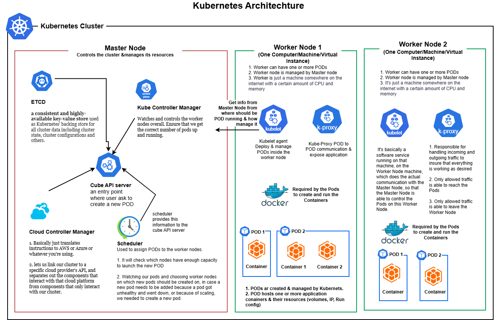

# Kubernetes

## What Kubernetes IS NOT

- **Cloud Service Provider**: It is not a cloud provider or a service owned by one.
- **Vendor-Locked**: It is not restricted to any specific cloud service provider.
- **Basic Local Software**: It is not just a software package you run on a single machine.
- **Docker Replacement**: It is not an alternative to Docker.
- **Paid Commercial Product**: It is not a paid service.

## What Kubernetes IS

- **Open-Source Project**: It is a free, open-source project.
- **Cloud-Agnostic**: It can be used seamlessly with any cloud provider.
- **Ecosystem of Tools**: It is a comprehensive collection of architectural concepts and tools.
- **Container Orchestrator**: It works directly with Docker and other container technologies.



## Core Components

- **Cluster**: A set of Node machines which are running the Containerized Application (Worker Nodes) or control other Nodes (Master Node)
- **Nodes**: Physical or virtual machine with a certain hardware capacity which hosts one or multiple Pods and communicates with the Cluster
- **Master Node**: Cluster Control Plane, managing the Pods across Worker Nodes
- **Worker Node**: Hosts Pods, running App Containers (+ resources)
- **Pods**: Pods hold the actual running App Containers + their required resources (e.g. volumes)
- **Containers**: Normal (Docker) Containers
- **Services**: A logical set (group) of Pods with a unique, Pod- and Container-independent IP address

---

## Kubernetes Architecture

The diagram below shows how all core components relate to each other inside a Kubernetes Cluster.

```
┌─────────────────────────────────────────────────────────────────────────┐
│                            CLUSTER                                      │
│                                                                         │
│  ┌──────────────────────────────┐                                       │
│  │        MASTER NODE           │                                       │
│  │   (Cluster Control Plane)    │                                       │
│  │                              │                                       │
│  │  ┌────────────────────────┐  │                                       │
│  │  │    API Server          │  │  ← Entry point for all commands       │
│  │  └────────────────────────┘  │                                       │
│  │  ┌────────────────────────┐  │                                       │
│  │  │    Scheduler           │  │  ← Assigns Pods to Worker Nodes       │
│  │  └────────────────────────┘  │                                       │
│  │  ┌────────────────────────┐  │                                       │
│  │  │  Controller Manager    │  │  ← Monitors & reconciles cluster state│
│  │  └────────────────────────┘  │                                       │
│  │  ┌────────────────────────┐  │                                       │
│  │  │       etcd             │  │  ← Distributed key-value state store  │
│  │  └────────────────────────┘  │                                       │
│  └──────────────────────────────┘                                       │
│                 │  controls & schedules                                  │
│                 ▼                                                        │
│  ┌──────────────────────┐   ┌──────────────────────┐                   │
│  │     WORKER NODE 1    │   │     WORKER NODE 2    │  ...              │
│  │                      │   │                      │                   │
│  │  ┌────────────────┐  │   │  ┌────────────────┐  │                   │
│  │  │    SERVICE     │  │   │  │    SERVICE     │  │                   │
│  │  │  (stable IP)   │  │   │  │  (stable IP)   │  │                   │
│  │  └───────┬────────┘  │   │  └───────┬────────┘  │                   │
│  │          │ routes to │   │          │ routes to │                   │
│  │  ┌───────▼────────┐  │   │  ┌───────▼────────┐  │                   │
│  │  │     POD A      │  │   │  │     POD C      │  │                   │
│  │  │ ┌────────────┐ │  │   │  │ ┌────────────┐ │  │                   │
│  │  │ │ Container  │ │  │   │  │ │ Container  │ │  │                   │
│  │  │ └────────────┘ │  │   │  │ └────────────┘ │  │                   │
│  │  │ ┌────────────┐ │  │   │  └────────────────┘  │                   │
│  │  │ │  Volumes   │ │  │   │  ┌────────────────┐  │                   │
│  │  │ └────────────┘ │  │   │  │     POD D      │  │                   │
│  │  └────────────────┘  │   │  │ ┌────────────┐ │  │                   │
│  │  ┌────────────────┐  │   │  │ │ Container  │ │  │                   │
│  │  │     POD B      │  │   │  │ └────────────┘ │  │                   │
│  │  │ ┌────────────┐ │  │   │  └────────────────┘  │                   │
│  │  │ │ Container  │ │  │   │                      │                   │
│  │  │ └────────────┘ │  │   │  ┌────────────────┐  │                   │
│  │  └────────────────┘  │   │  │    kubelet     │  │                   │
│  │                      │   │  │  kube-proxy    │  │                   │
│  │  ┌────────────────┐  │   │  └────────────────┘  │                   │
│  │  │    kubelet     │  │   └──────────────────────┘                   │
│  │  │  kube-proxy    │  │                                               │
│  │  └────────────────┘  │                                               │
│  └──────────────────────┘                                               │
└─────────────────────────────────────────────────────────────────────────┘
```

### How the components interact

| Component | Role | Communicates With |
|---|---|---|
| **Cluster** | Top-level boundary grouping all nodes and resources | Contains Master Node + Worker Nodes |
| **Master Node** | Control Plane — makes global decisions about the cluster | API Server talks to all Worker Nodes via kubelet |
| **API Server** | Single entry point for `kubectl` commands and internal calls | Scheduler, Controller Manager, etcd, kubelets |
| **Scheduler** | Watches for unscheduled Pods and assigns them to a Worker Node | API Server |
| **Controller Manager** | Runs controllers that reconcile desired vs actual state | API Server |
| **etcd** | Persistent store for all cluster state | API Server only |
| **Worker Node** | Runs the actual workloads (Pods & Containers) | Registers with Master Node via kubelet |
| **kubelet** | Agent on each Worker Node; ensures Pods are running | API Server |
| **kube-proxy** | Maintains network rules on each Node for Service routing | API Server |
| **Pod** | Smallest deployable unit; wraps one or more Containers + Volumes | Exposed via a Service |
| **Container** | Docker container running the application code | Lives inside a Pod |
| **Service** | Stable virtual IP + DNS name that load-balances traffic to Pods | Routes to matching Pods via label selectors |

### Request flow (end to end)

1. A user runs `kubectl apply` → request hits the **API Server** on the **Master Node**.
2. The **Scheduler** picks a suitable **Worker Node** for any new **Pods**.
3. The **kubelet** on that **Worker Node** pulls the image and starts the **Container** inside the **Pod**.
4. A **Service** is created with a stable IP and a label selector pointing to those **Pods**.
5. Incoming traffic hits the **Service** IP → **kube-proxy** routes it to a healthy **Pod** → the **Container** handles the request.

---

## What You Need to Set Up

Before working with Kubernetes you need two things:

1. **A Cluster** — the technical infrastructure (master node + worker nodes with all software installed)
2. **kubectl** — your local communication tool for sending instructions to the cluster

### The Cluster

The cluster needs real machines (physical or virtual) with all required software installed on them. The master node may be distributed across multiple machines in production to ensure high availability — if the single master fails, the entire cluster has a problem. For local development a single master node machine is sufficient.

**Master Node — required software:**

| Component            | Role                                                                |
|----------------------|---------------------------------------------------------------------|
| API Server           | Entry point for all commands; exposes the Kubernetes API            |
| Scheduler            | Decides which worker node a new Pod should run on                   |
| Controller Manager   | Runs reconciliation loops to maintain desired state                 |
| etcd                 | Distributed key-value store holding all cluster state               |

**Worker Node(s) — required software:**

| Component      | Role                                                                      |
|----------------|---------------------------------------------------------------------------|
| Docker         | Container runtime that runs your application images                       |
| kubelet        | Agent that talks to the master node and manages Pods on the node          |
| kube-proxy     | Manages networking rules; routes traffic between Pods and Services        |

```
┌─────────────────────────────────────────────────────────────────────────────┐
│                      REQUIRED SETUP AT A GLANCE                             │
│                                                                             │
│   ┌─────────────────────────────────────────────────────────────────────┐   │
│   │                          CLUSTER                                     │   │
│   │                 (Cloud / Data Center / Local VM)                    │   │
│   │                                                                     │   │
│   │   ┌──────────────────────────┐   ┌────────────────────────────┐    │   │
│   │   │       MASTER NODE        │   │      WORKER NODE(S)         │    │   │
│   │   │  (may be distributed     │   │   (one or more machines)    │    │   │
│   │   │   for high availability) │   │                            │    │   │
│   │   │                          │   │   ✔ Docker                  │    │   │
│   │   │   ✔ API Server            │   │   ✔ kubelet                 │    │   │
│   │   │   ✔ Scheduler             │   │   ✔ kube-proxy              │    │   │
│   │   │   ✔ Controller Manager    │   │   ✔ Container Runtime       │    │   │
│   │   │   ✔ etcd                  │   │                            │    │   │
│   │   └──────────────────────────┘   └────────────────────────────┘    │   │
│   └─────────────────────────────────────────────────────────────────────┘   │
│                              ▲                                              │
│                              │  sends instructions via API                  │
│   ┌──────────────────────────┴──────────────────────────┐                  │
│   │                YOUR LOCAL MACHINE                    │                  │
│   │                                                     │                  │
│   │   ✔ kubectl  (kube-control) — installed locally     │                  │
│   └─────────────────────────────────────────────────────┘                  │
└─────────────────────────────────────────────────────────────────────────────┘
```

---

## kubectl — Your Communication Device

`kubectl` (kube-control) is the CLI tool you install **locally on your machine** to send instructions to any Kubernetes cluster — whether it is a local minikube cluster or a cloud cluster on AWS, GCP, or Azure.

> ⚠️ **Do not confuse kubectl with the API Server or the Master Node.**
> - `kubectl` is what *gives* the commands (local tool on your machine).
> - The **Master Node / API Server** is what *receives and executes* those commands (lives inside the cluster).

### What you can do with kubectl

```bash
kubectl apply -f deployment.yaml       # Create or update resources from a YAML file
kubectl create deployment my-app \
  --image=my-image:v1                  # Create a new deployment
kubectl get pods                       # List all running Pods
kubectl get deployments                # List all Deployments
kubectl scale deployment my-app \
  --replicas=5                         # Scale a Deployment
kubectl delete deployment my-app      # Delete a Deployment
kubectl logs <pod-name>               # View logs of a Pod
kubectl describe pod <pod-name>       # Detailed info about a Pod
```

### The Command Chain

```
┌─────────────────────────────────────────────────────────────────────────────┐
│                         HOW kubectl FITS IN                                  │
│                                                                             │
│   You (Developer / Admin)                                                   │
│        │                                                                    │
│        │  types a command                                                   │
│        ▼                                                                    │
│   ┌──────────────────┐                                                      │
│   │     kubectl      │  ←── Installed locally; works with ANY cluster       │
│   │  (kube-control)  │      minikube · AWS EKS · Google GKE · Azure AKS    │
│   └────────┬─────────┘                                                      │
│            │  sends API requests                                            │
│            ▼                                                                │
│   ┌──────────────────┐                                                      │
│   │   API Server     │  ←── Runs on the Master Node (inside the cluster)    │
│   │  (Master Node)   │      Receives instructions and coordinates execution │
│   └────────┬─────────┘                                                      │
│            │  coordinates via kubelet                                       │
│            ▼                                                                │
│   ┌──────────────────────────────────────────┐                              │
│   │              Worker Nodes                │                              │
│   │   ┌──────────┐   ┌──────────┐            │                              │
│   │   │ Worker 1 │   │ Worker 2 │   ...      │                              │
│   │   │  Pods    │   │  Pods    │            │                              │
│   │   └──────────┘   └──────────┘            │                              │
│   └──────────────────────────────────────────┘                              │
└─────────────────────────────────────────────────────────────────────────────┘
```

### The Analogy

| Role       | Kubernetes equivalent | What it does                                              |
|------------|-----------------------|-----------------------------------------------------------|
| President  | **kubectl**           | Issues the command (the *what*)                           |
| General    | **Master Node**       | Receives the order; ensures it is executed correctly      |
| Soldiers   | **Worker Nodes**      | Carry out the actual work (run and manage Pods/containers)|

---

## minikube — Local Cluster for Development & Testing

For learning and testing you do not need a real cloud cluster. **minikube** creates a single-node cluster inside a virtual machine on your local machine, combining the master and worker roles in one VM.

```
┌─────────────────────────────────────────────────────────────────────────────┐
│                        MINIKUBE: LOCAL CLUSTER                               │
│                                                                             │
│   Your Physical Machine                                                     │
│   ┌─────────────────────────────────────────────────────────────────────┐   │
│   │                                                                     │   │
│   │   ┌─────────────────────────────────────────────────────────────┐   │   │
│   │   │           Virtual Machine (managed by minikube)              │   │   │
│   │   │                                                             │   │   │
│   │   │   ┌──────────────────────────────────────────────────────┐  │   │   │
│   │   │   │     Single-Node Kubernetes Cluster                    │  │   │   │
│   │   │   │                                                      │  │   │   │
│   │   │   │   Master Node + Worker Node  (combined in one VM)    │  │   │   │
│   │   │   │                                                      │  │   │   │
│   │   │   │   ✔ API Server  ✔ Scheduler  ✔ etcd                  │  │   │   │
│   │   │   │   ✔ kubelet     ✔ Docker     ✔ kube-proxy            │  │   │   │
│   │   │   └──────────────────────────────────────────────────────┘  │   │   │
│   │   └─────────────────────────────────────────────────────────────┘   │   │
│   │                                                                     │   │
│   │   kubectl  ── talks to the minikube cluster exactly as it would     │   │
│   │               talk to a real cloud cluster (same commands)          │   │
│   └─────────────────────────────────────────────────────────────────────┘   │
└─────────────────────────────────────────────────────────────────────────────┘
```

| Property              | Value                                                          |
|-----------------------|----------------------------------------------------------------|
| **Purpose**           | Local Kubernetes cluster for development & testing            |
| **Supported OS**      | Linux, macOS, Windows                                         |
| **Cluster type**      | Single-node — master + worker combined in one VM              |
| **Replaces kubectl?** | ❌ No — kubectl must be installed separately                  |
| **Use in production?**| ❌ No — development/testing only                              |

> minikube does **not** replace kubectl. You always need kubectl installed locally — it is the tool you use to communicate with any cluster, whether local (minikube) or cloud (AWS EKS, GKE, AKS).

### Installation Summary

**Two things to install (in this order):**

```
Step 1 — kubectl
  macOS:   brew install kubectl
  Windows: choco install kubernetes-cli
  Linux:   https://kubernetes.io/docs/tasks/tools/

Step 2 — minikube
  macOS:   brew install minikube
  Windows: choco install minikube
  Linux:   https://minikube.sigs.k8s.io/docs/start/

Step 3 — start and verify
  minikube start
  kubectl get nodes
```

### Local vs. Cloud Setup

```
┌───────────────────────────────┬─────────────────────────────────────────────┐
│        LOCAL (minikube)       │       CLOUD (EKS / GKE / AKS)               │
├───────────────────────────────┼─────────────────────────────────────────────┤
│ minikube + kubectl locally    │ kubectl locally only                         │
│ Cluster lives in a local VM   │ Cluster lives in the cloud                  │
│ Master + worker in one VM     │ Separate, distributed cloud machines         │
│ Single node — no HA           │ High availability by default                 │
│ Development / testing only    │ Suitable for production                      │
│ Same kubectl commands work    │ Same kubectl commands work                   │
└───────────────────────────────┴─────────────────────────────────────────────┘
```

---

## kubectl vs minikube — Key Differences

These two tools are often used together locally, but they have very different responsibilities.

```
┌──────────────────────────────────────────┬──────────────────────────────────────────┐
│               kubectl                    │               minikube                   │
│         Local + Cloud + Production       │         Primarily Local Development      │
├──────────────────────────────────────────┼──────────────────────────────────────────┤
│  The command-line tool used to           │  A tool that creates and runs a          │
│  communicate with any Kubernetes         │  Kubernetes cluster on your local        │
│  cluster.                                │  machine (e.g. your Windows laptop).     │
│                                          │                                          │
│  Examples:                               │  Examples:                               │
│  • Deploy applications                   │  • Learn Kubernetes                      │
│  • Check Pods and Services               │  • Test deployments locally              │
│  • Scale applications                    │  • Practice Pods, Services,              │
│  • View logs and troubleshoot failures   │    ConfigMaps and Secrets                │
│                                          │  • Experiment without a cloud cluster    │
└──────────────────────────────────────────┴──────────────────────────────────────────┘
```

> 🔑 **Important:** `kubectl` does **not** create a cluster by itself — it manages a cluster that already exists. `minikube` creates a local Kubernetes cluster, which you then manage using `kubectl`.

---

## Where Are They Used?

| Environment              | kubectl | minikube                        |
|--------------------------|---------|---------------------------------|
| Local laptop             | ✅ Yes  | ✅ Yes — to create a local cluster |
| Development / testing    | ✅ Yes  | Sometimes                       |
| AWS / Azure / GCP        | ✅ Yes  | ❌ Generally not used           |
| Enterprise production    | ✅ Yes  | ❌ Generally not used           |

---

## How They Work Together

```
┌─────────────────────────────────────────────────────────────────────────────┐
│                      kubectl + minikube TOGETHER                             │
│                                                                             │
│   You run kubectl commands                                                  │
│   Example: kubectl get pods                                                 │
│        │                                                                    │
│        ▼                                                                    │
│   ┌──────────────────────────┐                                              │
│   │   Kubernetes API Server  │  Receives and processes your request         │
│   └──────────────┬───────────┘                                              │
│                  │                                                          │
│                  ▼                                                          │
│   ┌──────────────────────────────────────────────────────────────────┐     │
│   │                   Kubernetes Cluster                              │     │
│   │          Scheduler · Worker Nodes · Pods · Containers            │     │
│   │                                                                  │     │
│   │   ← Could be running locally (minikube) or in the cloud (EKS)   │     │
│   └──────────────────────────────────────────────────────────────────┘     │
│                                                                             │
│  You can use the same kubectl commands with different clusters by           │
│  switching your Kubernetes context:                                         │
│  kubectl config use-context <context-name>                                  │
└─────────────────────────────────────────────────────────────────────────────┘
```

---

## Example Using Docker Desktop (Windows)

Since Docker Desktop is already installed, you can practice Kubernetes locally — either with minikube or with Docker Desktop's built-in Kubernetes option (no minikube needed).

### With minikube:

```bash
# Start the local cluster
minikube start

# Verify nodes are ready
kubectl get nodes

# List all Pods across all namespaces
kubectl get pods -A

# Create a simple NGINX deployment
kubectl create deployment nginx --image=nginx

# Verify the deployment
kubectl get deployments
```

> `minikube start` creates and starts the local cluster.
> `kubectl` commands interact with it — exactly the same way they would with a cloud cluster.

> **Docker Desktop alternative:** Docker Desktop ships with its own local Kubernetes cluster. Enable it in *Settings → Kubernetes → Enable Kubernetes*. This means you do not need minikube if you already have Docker Desktop.

---

## Simple Rule to Remember

```
┌─────────────────────────────────────────────────────────────────────────────┐
│                                                                             │
│   kubectl    =  The remote control for Kubernetes                           │
│                 (works with any cluster — local or cloud)                   │
│                                                                             │
│   minikube   =  A tool to create a local Kubernetes playground              │
│                 (spins up a cluster on your machine for learning/testing)   │
│                                                                             │
│   Production =  A cluster provided by EKS / AKS / GKE                      │
│   Kubernetes    (managed using kubectl — same commands, bigger scale)       │
│                                                                             │
└─────────────────────────────────────────────────────────────────────────────┘
```
