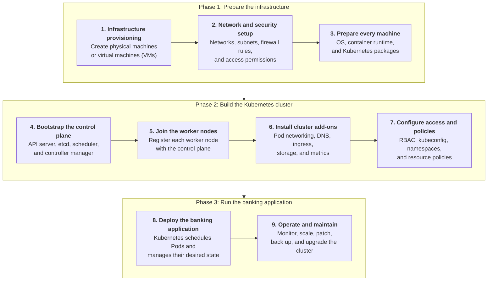
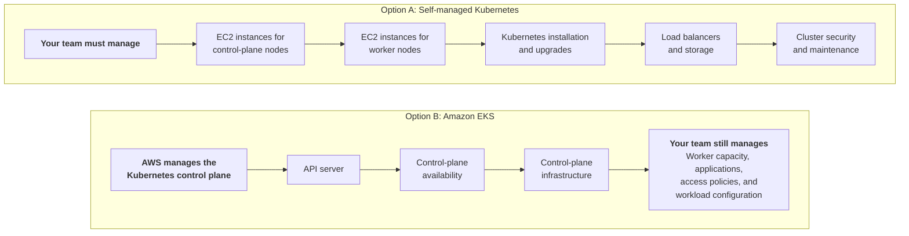
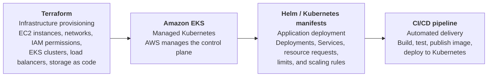
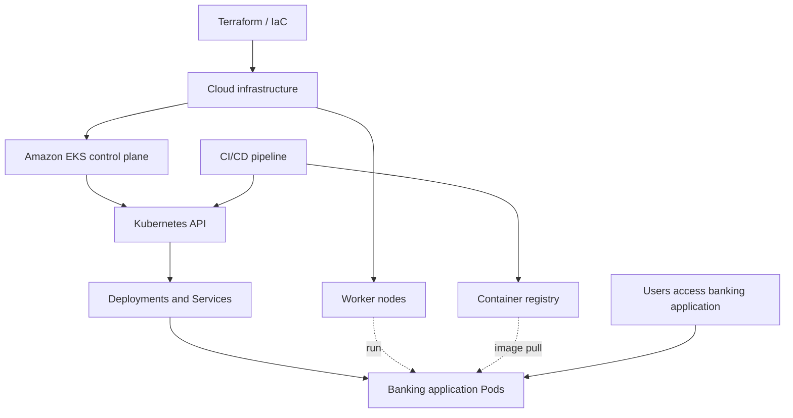

# Kubernetes Limitations: It Does Not Provision the Machines for You

Kubernetes manages your applications and cluster resources, but it does **not** automatically create and prepare all the underlying machines in a self-managed environment.

The examples below use an enterprise banking application.

## 1. What is the problem ?

Imagine you want to deploy a banking frontend, backend API, and payment service using Kubernetes. Before Kubernetes can schedule your Pods, you need infrastructure on which Kubernetes can run.

### Diagram 1

```mermaid
flowchart LR
    A["<b>1. Infrastructure provisioning</b><br/>Create physical machines or virtual machines (VMs)"]
    B["<b>2. Network and security setup</b><br/>Create networks, subnets, firewall rules, and access permissions"]
    C["<b>3. Prepare every machine</b><br/>Install the operating system, container runtime, and Kubernetes packages"]
    D["<b>4. Bootstrap the control plane</b><br/>Initialise the API server, etcd, scheduler, and controller manager"]
    E["<b>5. Join the worker nodes</b><br/>Register each worker node with the control plane"]
    F["<b>6. Install cluster add-ons</b><br/>Pod networking, DNS, ingress, storage, and metrics"]
    G["<b>7. Configure access and policies</b><br/>RBAC, kubeconfig, namespaces, and resource policies"]
    H["<b>8. Deploy the banking application</b><br/>Kubernetes schedules Pods and manages their desired state"]
    I["<b>9. Operate and maintain</b><br/>Monitor, scale, patch, back up, and upgrade the cluster"]
    A --> B --> C --> D --> E --> F --> G --> H --> I
```

### Diagram 2

In a self-managed environment, someone must provision the machines and install or configure the necessary Kubernetes components before the cluster can run workloads.

## 2. Who manages what?

| Responsibility | Self-managed Kubernetes | Managed Kubernetes |
|---|---|---|
| Create physical machines or VMs | Infrastructure / platform team | Cloud provider for the control plane; customer provisions or configures worker capacity, depending on the service |
| Install and manage the control plane | Your team | Cloud provider |
| Install and maintain worker-node components | Your team | Provider tooling or managed node service, depending on configuration |
| Deploy application Pods | Application / DevOps team | Application / DevOps team |
| Configure application scaling | Platform / DevOps team | Platform / DevOps team |
| Configure storage and networking | Shared responsibility | Shared responsibility |

## 3. AWS example: self-managed vs. managed Kubernetes

### Option A: Self-managed Kubernetes

Your team must manage:

- EC2 instances for control-plane nodes
- EC2 instances for worker nodes
- Kubernetes installation and upgrades
- Load balancers and storage
- Cluster security and maintenance

### Option B: Amazon EKS

AWS manages the Kubernetes control plane:

- API server
- Control-plane availability
- Control-plane infrastructure

Your team still manages worker capacity, applications, access policies, and workload configuration according to the chosen EKS setup.

> For AWS, the managed service is **Amazon EKS**. You generally do not need to create and maintain your own Kubernetes control-plane EC2 instances when using EKS.

## 4. How do we avoid all this manual work?

The key point of the lecture: **Infrastructure as Code (IaC)** and **managed Kubernetes services**.

| Tool / approach | Role | What it does |
|---|---|---|
|    **Terraform** | Infrastructure provisioning | Define EC2 instances, networks, IAM permissions, EKS clusters, load balancers, and storage as code instead of creating them manually. |
|    **Amazon EKS** | Managed Kubernetes | AWS manages the Kubernetes control plane, reducing the operational work required to run a cluster. |
|    **Helm / Kubernetes manifests** | Application deployment | Define Deployments, Services, resource requests, limits, and scaling rules declaratively. |
|    **CI/CD pipeline** | Automated delivery | Build and test the application, publish the container image, and deploy the updated version to Kubernetes. |

## 5. The enterprise banking workflow

The important distinction is that Kubernetes automation and infrastructure automation solve different problems:

- Kubernetes automates workload scheduling, recovery, service discovery, and application scaling.
- Terraform or similar tools automate the creation and configuration of infrastructure.
- Managed Kubernetes reduces the amount of cluster infrastructure you must operate.
- CI/CD automates the process of delivering application changes.

> **Remember:** Kubernetes does not automatically mean zero infrastructure management. In a modern enterprise, teams combine managed Kubernetes, Infrastructure as Code, and CI/CD to avoid manually creating and configuring every resource for every deployment.
