# Kubernetes Foundation Roadmap — Complete Lesson List

This roadmap takes you from Kubernetes fundamentals to practical, enterprise-level architecture, in a structured order. Since you're learning Docker, container runtimes, worker nodes, Pods, and Kubernetes architecture, it starts with those foundations and gradually moves into deployment, networking, storage, security, and production operations.

## Roadmap Overview

| Phase | Title | Lessons | Focus |
|-------|-------|---------|-------|
| Phase 1 | Container & Kubernetes Fundamentals | 1–5 | Core concepts and architecture |
| Phase 2 | Kubernetes Workloads | 6–10 | Pods, Deployments, configuration and scaling |
| Phase 3 | Networking & Storage | 11–14 | Services, DNS, Ingress, volumes and persistence |
| Phase 4 | Production Kubernetes | 15–20 | Security, scheduling, reliability and observability |
| Phase 5 | Enterprise & Cloud-Native Operations | 21–25 | Helm, CI/CD, GitOps, managed clusters and capstone |

---

## Complete Kubernetes Foundation Syllabus

### Your Lesson Tracker

**1 of 89 lessons completed (1%)**

| Phase | Title | Lessons | Progress |
|-------|-------|---------|----------|
| 1 | Foundations & Architecture | 1–10 | 0/10 |
| 2 | kubectl, YAML & Workloads | 11–23 | 0/13 |
| 3 | Kubernetes Networking | 24–31 | 0/8 |
| 4 | Storage & Persistence | 32–38 | 0/7 |
| 5 | Scheduling, Scaling & Reliability | 39–49 | 0/11 |
| 6 | Security & Access Control | 50–58 | 0/9 |
| 7 | Monitoring, Logging & Troubleshooting | 59–68 | 0/10 |
| 8 | Administration & Enterprise Architecture | 69–79 | 0/11 |
| 9 | DevOps, GitOps & Capstone | 80–89 | 1/10 |

---

## Phase 1 — Foundations & Architecture (0/10 lessons completed)

**Explanation:** This phase builds the mental model everything else depends on. You learn why Kubernetes exists, how containers differ from VMs, how the container runtime layer works, and how the control plane and worker nodes cooperate to keep your desired state running.

**Outcome:** You can explain how a Kubernetes cluster works internally and stand up a local cluster.

**Phase 1 diagram:**

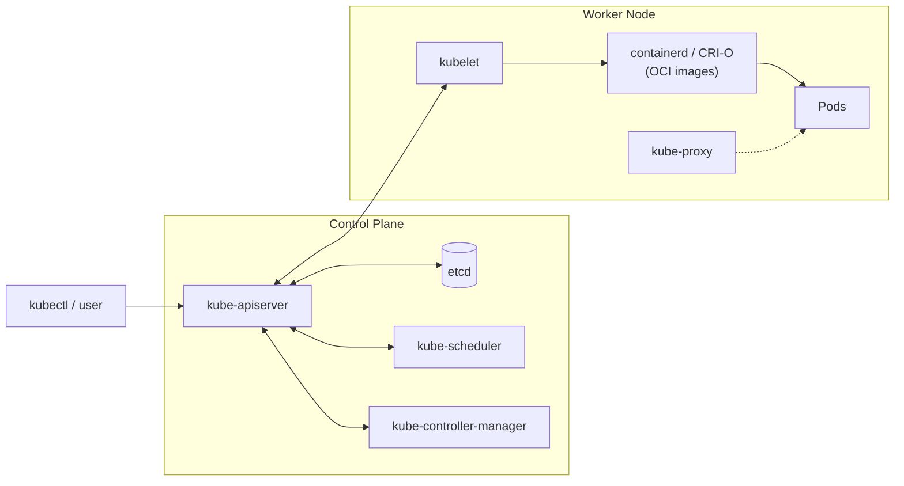


### 1. Introduction to Kubernetes
- [ ] What Kubernetes is, why it exists, benefits and limitations

**Essential info:**
- Kubernetes (K8s) is an open-source container orchestrator originally built at Google and now maintained by the CNCF.
- It solves: scheduling containers across many machines, self-healing, scaling, rolling updates, service discovery and load balancing.
- It works declaratively: you describe the desired state, and Kubernetes continuously works to match it.
- Limitations: it does not provision machines or networks for you in a self-managed setup (see [`35-Kubernetes_Limitations`](../35-Kubernetes_Limitations/README.md)), has a steep learning curve, and adds operational overhead for small apps.

### 2. Traditional vs VM vs Containers
- [ ] Physical servers, virtual machines, containers and orchestration

**Essential info:**
- **Physical servers:** one OS per machine, poor utilization, slow provisioning.
- **VMs:** a hypervisor runs multiple guest OSes; strong isolation but heavy (GBs, minutes to boot).
- **Containers:** share the host kernel and isolate processes using namespaces and cgroups; lightweight (MBs, seconds to start).
- **Orchestration:** needed once you run many containers across many hosts; that is Kubernetes' role.

### 3. Docker Fundamentals Revision
- [ ] Docker images, containers, Dockerfile, ports, volumes and networks

**Essential info:**
- An **image** is a read-only layered template; a **container** is a running instance of an image.
- A **Dockerfile** defines the build: `FROM`, `COPY`, `RUN`, `EXPOSE`, `CMD`/`ENTRYPOINT`.
- `-p host:container` publishes ports; volumes persist data; user-defined bridge networks give containers DNS by name.
- Key commands: `docker build`, `docker run`, `docker ps`, `docker logs`, `docker exec`, `docker push`.

### 4. Container Images & Runtime
- [ ] OCI images, CRI, containerd, CRI-O and Docker Engine

**Essential info:**
- **OCI** (Open Container Initiative) standardizes the image format and runtime specification.
- **CRI** (Container Runtime Interface) is the API the kubelet uses to talk to runtimes.
- **containerd** and **CRI-O** are CRI-compliant runtimes; both use **runc** to actually create containers.
- Kubernetes removed built-in Docker Engine support (dockershim) in v1.24. Docker-built images still work because they follow the OCI format.

### 5. Kubernetes Cluster Architecture
- [ ] Control plane, worker nodes, cluster, namespaces and node resources

**Essential info:**
- A **cluster** = control plane + one or more worker nodes.
- The control plane makes decisions (scheduling, state); worker nodes run the Pods.
- **Namespaces** divide a cluster into logical groups (defaults: `default`, `kube-system`, `kube-public`, `kube-node-lease`).
- Each node exposes allocatable CPU, memory and Pod capacity; check with `kubectl describe node <name>`.

### 6. Control Plane Components
- [ ] kube-apiserver, etcd, kube-scheduler, kube-controller-manager

**Essential info:**
- **kube-apiserver:** the only entry point to the cluster; validates and processes all REST requests.
- **etcd:** consistent key-value store holding all cluster state; back it up regularly.
- **kube-scheduler:** assigns unscheduled Pods to suitable nodes.
- **kube-controller-manager:** runs controllers (Node, ReplicaSet, Deployment, Job and others) that reconcile state.
- **cloud-controller-manager** (cloud setups) integrates with cloud provider APIs.

### 7. Worker Node Components
- [ ] kubelet, container runtime, kube-proxy and CNI

**Essential info:**
- **kubelet:** node agent that receives Pod specs and ensures the containers are running and healthy.
- **Container runtime:** pulls images and runs containers (containerd, CRI-O).
- **kube-proxy:** programs iptables/IPVS rules so Services route to Pods.
- **CNI plugin** (Calico, Cilium, Flannel): gives Pods IP addresses and cross-node connectivity.

### 8. How Kubernetes Works Internally
- [ ] API requests, reconciliation loops, desired state and actual state

**Essential info:**
- Flow of `kubectl apply`: request → API server (authN, authZ, admission) → saved in etcd → controllers create objects → scheduler picks a node → kubelet starts containers.
- **Reconciliation loop:** controllers constantly compare desired state (spec) with actual state (status) and act to close the gap.
- Components never talk to each other directly; they watch the API server for changes.

### 9. Scheduler & Resource Allocation
- [ ] CPU, RAM, requests, limits, placement and bin packing

**Essential info:**
- Scheduling happens in two steps: **filtering** (which nodes can run the Pod) then **scoring** (which is best).
- The scheduler places Pods based on resource **requests**, not actual usage.
- **Limits** cap usage at runtime: CPU is throttled, memory overuse causes OOMKill.
- Bin packing places Pods tightly to use fewer nodes; spreading improves resilience.
- CPU units: `1000m` = 1 core. Memory units: `Mi`, `Gi`.

### 10. Kubernetes Installation Options
- [ ] Minikube, kind, kubeadm and managed Kubernetes

**Essential info:**
- **Minikube:** single-node local cluster in a VM or container; good for learning.
- **kind:** runs cluster nodes as Docker containers; fast, ideal for CI and multi-node tests.
- **kubeadm:** bootstraps a real self-managed cluster on your own machines.
- **Managed (EKS, AKS, GKE):** the provider runs the control plane; you manage workloads and node pools.
- Quick start: `minikube start` or `kind create cluster`, then `kubectl get nodes`.

---

## Phase 2 — kubectl, YAML & Workloads (0/13 lessons completed)

**Explanation:** This is where you start working hands-on. You learn the `kubectl` CLI and YAML manifests, then build up the workload objects: Pods, ReplicaSets, Deployments, configuration, health probes, and batch or stateful workloads.

**Outcome:** You can write manifests and deploy, update, configure and monitor applications on a cluster.

**Phase 2 diagram:**

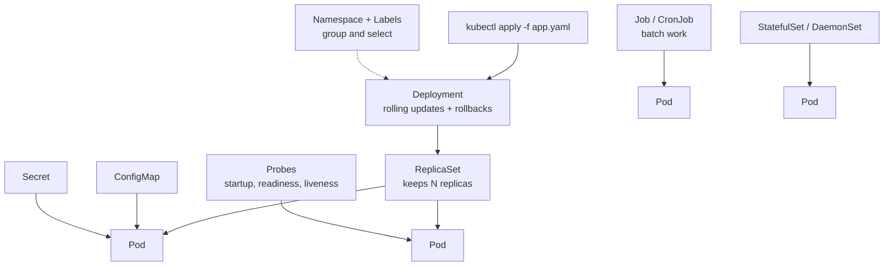


### 11. kubectl Fundamentals
- [ ] get, describe, logs, exec, apply, delete and explain

**Essential info:**
- `kubectl` talks to the API server using the kubeconfig file (`~/.kube/config`).
- Core commands:
  ```bash
  kubectl get pods -A -o wide
  kubectl describe pod <pod>
  kubectl logs <pod> -f
  kubectl exec -it <pod> -- /bin/sh
  kubectl apply -f file.yaml
  kubectl delete -f file.yaml
  kubectl explain pod.spec.containers
  ```
- Use `--dry-run=client -o yaml` to generate manifests quickly.
- Switch clusters with `kubectl config get-contexts` and `kubectl config use-context`.

### 12. Kubernetes YAML
- [ ] API version, kind, metadata, spec, status and labels

**Essential info:**
- Every object has four top-level fields: `apiVersion`, `kind`, `metadata`, `spec`.
- `status` is written by Kubernetes, not by you.
- `metadata` holds `name`, `namespace`, `labels` and `annotations`.
- Indentation uses spaces (never tabs); multiple objects can live in one file separated by `---`.

```yaml
apiVersion: v1
kind: Pod
metadata:
  name: demo
  labels:
    app: demo
spec:
  containers:
    - name: web
      image: nginx:1.27
```

### 13. Pods
- [ ] Pod lifecycle, multi-container Pods, sidecars and shared resources

**Essential info:**
- A Pod is the smallest deployable unit: one or more containers sharing one IP, network namespace and volumes.
- Phases: `Pending` → `Running` → `Succeeded` / `Failed` (or `Unknown`).
- Patterns: **sidecar** (logging/proxy), **init containers** (run to completion before app starts), **ambassador**, **adapter**.
- Pods are ephemeral; do not create bare Pods for production, use a controller.

### 14. ReplicaSets
- [ ] Replica management and maintaining the desired Pod count

**Essential info:**
- A ReplicaSet ensures a specified number of identical Pods are running at all times.
- It uses a label `selector` to find the Pods it owns and recreates any that die.
- You rarely create ReplicaSets directly; Deployments manage them for you.

### 15. Deployments
- [ ] Creating applications, replicas, updates and rollbacks

**Essential info:**
- A Deployment manages ReplicaSets and provides declarative updates, scaling and rollback.
- Key fields: `replicas`, `selector`, `template`, `strategy`.
- Commands:
  ```bash
  kubectl create deployment web --image=nginx --replicas=3
  kubectl scale deployment web --replicas=5
  kubectl set image deployment/web nginx=nginx:1.27
  ```
- Changing the Pod template triggers a new ReplicaSet and a rollout.

### 16. Rolling Updates & Rollbacks
- [ ] Deployment strategies, rollout history and recovery

**Essential info:**
- Default strategy is `RollingUpdate`, tuned by `maxSurge` and `maxUnavailable`; the alternative is `Recreate` (downtime).
- Commands:
  ```bash
  kubectl rollout status deployment/web
  kubectl rollout history deployment/web
  kubectl rollout undo deployment/web
  kubectl rollout undo deployment/web --to-revision=2
  ```
- `revisionHistoryLimit` controls how many old ReplicaSets are kept for rollback.

### 17. Namespaces & Labels
- [ ] Logical isolation, selectors, annotations and organization

**Essential info:**
- **Namespaces** scope names and allow per-namespace quotas and RBAC: `kubectl create ns dev`, `kubectl get pods -n dev`.
- **Labels** are key-value pairs used by selectors (`app=web,env=prod`); **annotations** hold non-identifying metadata (build info, tool config).
- Selector examples: `kubectl get pods -l app=web`, `-l 'env in (dev,qa)'`.
- Namespaces do not isolate network traffic by default; use NetworkPolicy.

### 18. ConfigMaps
- [ ] Externalizing application configuration

**Essential info:**
- Store non-sensitive configuration separately from the image.
- Consume as environment variables (`envFrom`, `configMapKeyRef`) or mounted files (volume).
- Create with `kubectl create configmap app-config --from-literal=MODE=prod` or `--from-file=`.
- Mounted ConfigMap files update eventually; env vars require a Pod restart. Maximum size is 1 MiB.

### 19. Secrets
- [ ] Sensitive configuration, access restrictions and encryption considerations

**Essential info:**
- Hold passwords, tokens and keys; types include `Opaque`, `kubernetes.io/tls`, `kubernetes.io/dockerconfigjson`.
- Values are only **base64-encoded**, not encrypted, by default. Enable encryption at rest in etcd and restrict access with RBAC.
- Consume as env vars or volume mounts; prefer volumes to reduce leakage through process listings.
- Production setups often use external secret managers (see Lesson 84).

### 20. Environment Variables & Commands
- [ ] env, command, args, entrypoints and container startup

**Essential info:**
- Kubernetes `command` overrides Docker `ENTRYPOINT`; `args` overrides Docker `CMD`.
- Set variables with `env` (literal, `valueFrom` ConfigMap/Secret, or Downward API like `fieldRef: metadata.name`).
- Variables can be referenced in other variables as `$(VAR_NAME)`.

```yaml
containers:
  - name: app
    image: busybox
    command: ["sh", "-c"]
    args: ["echo $GREETING"]
    env:
      - name: GREETING
        value: hello
```

### 21. Probes & Health Checks
- [ ] Startup, readiness and liveness probes

**Essential info:**
- **Liveness:** if it fails, the container is restarted.
- **Readiness:** if it fails, the Pod is removed from Service endpoints (no restart).
- **Startup:** protects slow-starting apps; liveness/readiness are disabled until it succeeds.
- Mechanisms: `httpGet`, `tcpSocket`, `exec`, `grpc`. Tune `initialDelaySeconds`, `periodSeconds`, `failureThreshold`.

### 22. Jobs & CronJobs
- [ ] One-time and scheduled workloads

**Essential info:**
- **Job:** runs Pods to completion; supports `completions`, `parallelism`, `backoffLimit`; `restartPolicy` must be `OnFailure` or `Never`.
- **CronJob:** creates Jobs on a cron schedule (`"*/5 * * * *"`); controls include `concurrencyPolicy` and `successfulJobsHistoryLimit`.
- Use for backups, reports, batch processing and cleanup tasks.

### 23. StatefulSets & DaemonSets
- [ ] Stateful applications and node-level workloads

**Essential info:**
- **StatefulSet:** stable Pod names (`db-0`, `db-1`), ordered startup/shutdown, stable network identity via a headless Service, and per-Pod storage through `volumeClaimTemplates`. Used for databases and clustered systems.
- **DaemonSet:** runs one Pod on every (or selected) node; used for log collectors, monitoring agents and CNI/storage plugins.

---

## Phase 3 — Kubernetes Networking (0/8 lessons completed)

**Explanation:** Networking is what makes many Pods behave like one application. You start with container networking basics, learn how Kubernetes assigns Pod IPs, then expose workloads using Services, DNS, Ingress and the Gateway API, and restrict traffic with Network Policies.

**Outcome:** You can expose applications, route traffic and control who can talk to whom.

**Phase 3 diagram:**

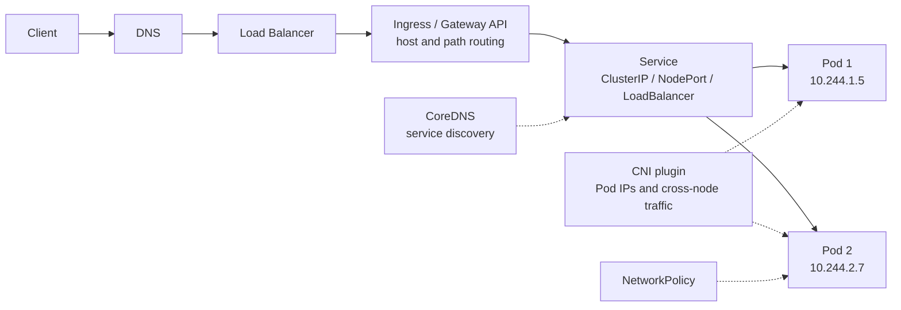


### 24. Container Networking Fundamentals
- [ ] IP addresses, ports, bridges and network namespaces

**Essential info:**
- Each container gets its own **network namespace** (own interfaces, routes, ports).
- A Linux **bridge** (such as `docker0`) connects containers; a **veth pair** links each container to the bridge.
- NAT/port publishing maps host ports to container ports.
- Inspect with `ip addr`, `ip route`, `docker network inspect bridge`.

### 25. Kubernetes Pod Networking
- [ ] Pod IPs, inter-Pod communication and CNI

**Essential info:**
- Kubernetes network model: every Pod has a unique IP, and all Pods can reach each other without NAT.
- Containers in the same Pod communicate over `localhost`.
- The **CNI plugin** implements this model (Calico, Cilium, Flannel, Weave); some also enforce NetworkPolicy.
- Pod IPs are ephemeral, which is why Services are needed.

### 26. Services
- [ ] ClusterIP, NodePort and LoadBalancer

**Essential info:**
- A Service gives Pods a stable virtual IP and DNS name, load balancing across Pods that match its selector.
- Types:
  - **ClusterIP** (default): internal only.
  - **NodePort:** opens a port (30000–32767) on every node.
  - **LoadBalancer:** provisions a cloud load balancer.
  - **ExternalName:** maps to an external DNS name.
  - **Headless** (`clusterIP: None`): returns Pod IPs directly; used with StatefulSets.
- Quick expose: `kubectl expose deployment web --port=80 --target-port=8080`.

### 27. Service Discovery & DNS
- [ ] Service names, DNS resolution and endpoints

**Essential info:**
- **CoreDNS** provides in-cluster DNS. Format: `<service>.<namespace>.svc.cluster.local`.
- Within the same namespace the short name `<service>` works.
- **EndpointSlices** list the Pod IPs behind a Service; check with `kubectl get endpoints <svc>`.
- No endpoints usually means the selector does not match or Pods are not Ready.

### 28. Ingress
- [ ] HTTP/HTTPS routing, hostnames, paths and ingress controllers

**Essential info:**
- Ingress defines Layer 7 rules (host and path routing, TLS termination) for external traffic.
- It needs an **Ingress controller** (NGINX, Traefik, HAProxy, cloud-native) to function.
- Use `ingressClassName` to select the controller; TLS certificates come from a Secret (often managed by cert-manager).
- One load balancer can serve many Services, saving cost versus a LoadBalancer per Service.

### 29. Gateway API Fundamentals
- [ ] Gateway, GatewayClass, HTTPRoute and modern traffic management

**Essential info:**
- Gateway API is the more expressive, role-oriented successor to Ingress.
- **GatewayClass:** the implementation type (infrastructure provider). **Gateway:** the listener/load balancer instance (cluster operator). **HTTPRoute:** routing rules (app developer).
- Supports header matching, traffic splitting (canary), redirects, and TCP/gRPC routes.

### 30. Network Policies
- [ ] Controlling ingress and egress traffic

**Essential info:**
- By default all Pods can talk to all Pods. NetworkPolicy adds allow-list rules.
- Once a Pod is selected by any policy, traffic not explicitly allowed for that direction is denied.
- Rules use `podSelector`, `namespaceSelector`, `ipBlock` with `policyTypes: [Ingress, Egress]`.
- Requires a CNI that enforces policies (Calico, Cilium); common pattern is a default-deny policy plus targeted allows.

### 31. Application Traffic Flow
- [ ] Client → load balancer → Service → Pod

**Essential info:**
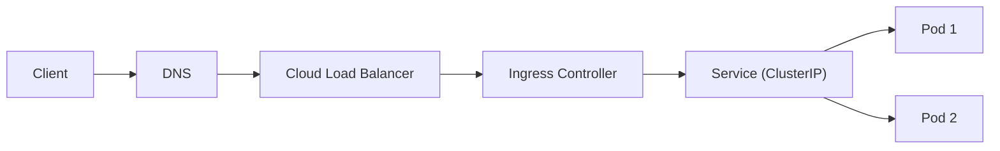
- kube-proxy rules on each node translate the Service IP to a healthy Pod IP.
- Debug in order: DNS → load balancer → Ingress → Service/endpoints → Pod readiness → application logs.

---

## Phase 4 — Storage & Persistence (0/7 lessons completed)

**Explanation:** Container filesystems are ephemeral, so data disappears when a Pod is replaced. This phase explains volumes, the PV/PVC model, dynamic provisioning, CSI, and how to run stateful applications safely.

**Outcome:** You can attach durable storage to applications and run stateful workloads safely.

**Phase 4 diagram:**

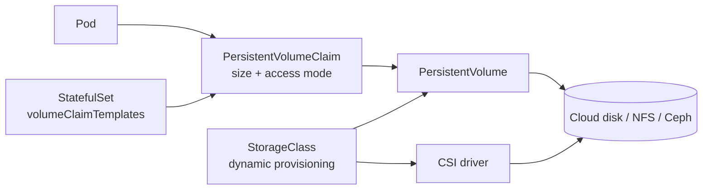


### 32. Container Storage vs Persistent Storage
- [ ] Ephemeral filesystems, bind mounts, volumes and cloud storage

**Essential info:**
- A container's writable layer is deleted with the container.
- Docker options: **bind mounts** (host path), **named volumes** (Docker-managed), **tmpfs** (memory).
- In Kubernetes, durable data must live on volumes backed by node-independent storage (cloud disks, NFS, Ceph and similar).
- Choose block storage (single-writer, databases) or file storage (shared, multi-writer).

### 33. Volumes & Volume Types
- [ ] emptyDir, hostPath and other volume sources

**Essential info:**
- A volume lives as long as its Pod (not its container), so data survives container restarts.
- **emptyDir:** scratch space deleted with the Pod; can be memory-backed.
- **hostPath:** mounts a node directory; risky and node-bound, use sparingly.
- Others: `configMap`, `secret`, `projected`, `downwardAPI`, `nfs`, `persistentVolumeClaim`.

### 34. PersistentVolumes (PV)
- [ ] Cluster storage resources and lifecycle

**Essential info:**
- A PV is a cluster-level storage resource, provisioned by an admin or dynamically.
- Key fields: `capacity`, `accessModes` (`ReadWriteOnce`, `ReadOnlyMany`, `ReadWriteMany`, `ReadWriteOncePod`), `persistentVolumeReclaimPolicy` (`Retain`, `Delete`), `storageClassName`.
- Lifecycle: `Available` → `Bound` → `Released` → (`Failed`).

### 35. PersistentVolumeClaims (PVC)
- [ ] Application storage requests and binding

**Essential info:**
- A PVC is a user's request for storage (size, access mode, class); Kubernetes binds it to a matching PV.
- Pods reference the claim in `volumes[].persistentVolumeClaim.claimName`.
- PVC stuck in `Pending` usually means no matching PV/StorageClass or an unmet topology constraint.
- PVCs are namespaced; PVs are not.

```yaml
apiVersion: v1
kind: PersistentVolumeClaim
metadata:
  name: data-pvc
spec:
  accessModes: ["ReadWriteOnce"]
  resources:
    requests:
      storage: 5Gi
```

### 36. StorageClasses & Dynamic Provisioning
- [ ] Automatic storage allocation

**Essential info:**
- A StorageClass defines a "tier" of storage (`provisioner`, `parameters`, `reclaimPolicy`, `volumeBindingMode`).
- A PVC referencing a StorageClass triggers automatic PV creation.
- `volumeBindingMode: WaitForFirstConsumer` delays provisioning until a Pod is scheduled, so the volume lands in the right zone.
- A default StorageClass is used when none is specified; `allowVolumeExpansion: true` permits resizing.

### 37. CSI Drivers
- [ ] How Kubernetes connects to storage systems

**Essential info:**
- **CSI** (Container Storage Interface) is the standard plugin API between Kubernetes and storage vendors.
- Drivers include AWS EBS/EFS CSI, Azure Disk/File CSI, GCE PD CSI, Ceph, and others.
- Typical components: a controller plugin (create/attach/snapshot volumes) and a node plugin (mount to the node).
- Enables features such as volume snapshots, cloning and expansion.

### 38. Stateful Applications & Databases
- [ ] Persistent data, StatefulSets, backups and recovery

**Essential info:**
- Use StatefulSets with `volumeClaimTemplates` so each replica keeps its own PVC across restarts.
- Databases need replication, a headless Service, correct probes, and often an Operator for lifecycle management.
- Back up with logical dumps, volume snapshots, and tools such as Velero; **test restores**.
- Managed databases (RDS, Cloud SQL) are often safer than self-hosting.

---

## Phase 5 — Scheduling, Scaling & Reliability (0/11 lessons completed)

**Explanation:** This phase teaches how Kubernetes decides where Pods run and how it keeps applications available under load and failure: resource sizing, placement rules, autoscaling, disruption control and resilient design.

**Outcome:** You can size workloads correctly, control placement, scale automatically and design for resilience.

**Phase 5 diagram:**

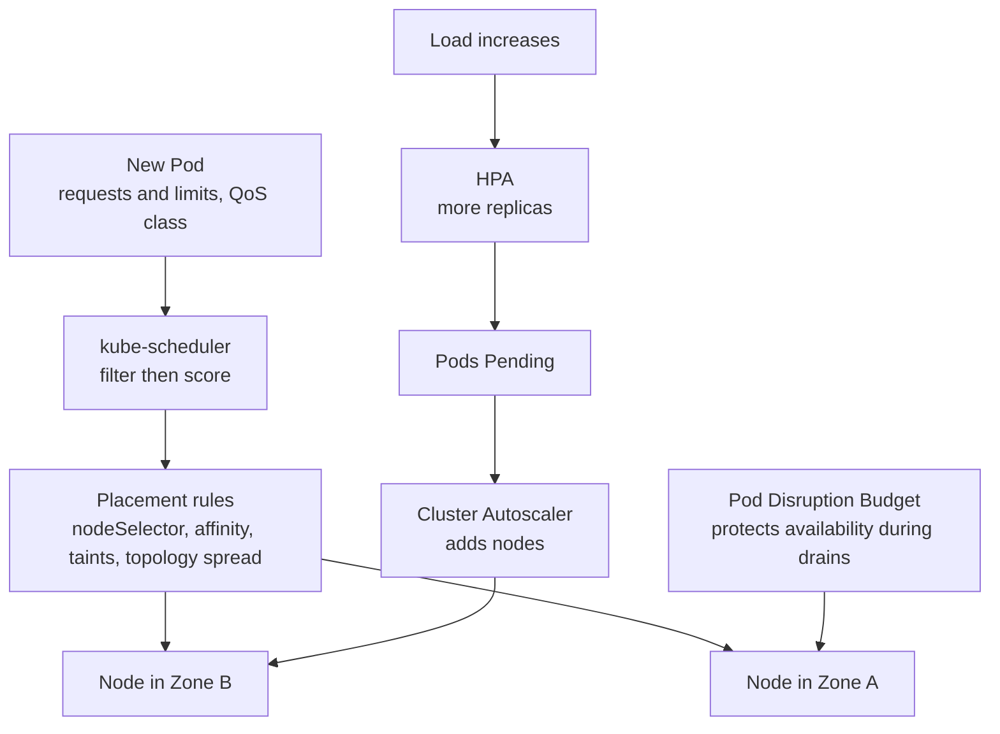


### 39. CPU & Memory Requests and Limits
- [ ] Resource reservations, constraints and throttling

**Essential info:**
- **Requests:** guaranteed minimum, used by the scheduler. **Limits:** hard maximum at runtime.
- Exceeding the CPU limit causes throttling; exceeding the memory limit causes `OOMKilled`.
- Always set memory requests; be careful with tight CPU limits as they can cause latency.
- Check usage with `kubectl top pod`.

```yaml
resources:
  requests: { cpu: "250m", memory: "256Mi" }
  limits:   { cpu: "500m", memory: "512Mi" }
```

### 40. Quality of Service (QoS)
- [ ] Guaranteed, Burstable and BestEffort

**Essential info:**
- **Guaranteed:** every container has requests equal to limits for CPU and memory.
- **Burstable:** at least one request or limit is set, but not Guaranteed.
- **BestEffort:** no requests or limits at all.
- Under node memory pressure, eviction order is BestEffort → Burstable → Guaranteed.

### 41. Node Selectors & Affinity
- [ ] Controlling Pod placement

**Essential info:**
- `nodeSelector`: simple label match (`disktype: ssd`).
- **Node affinity:** expressive rules; `requiredDuringSchedulingIgnoredDuringExecution` (hard) and `preferredDuringScheduling...` (soft).
- Label nodes with `kubectl label node <node> disktype=ssd`.

### 42. Taints & Tolerations
- [ ] Keeping workloads off selected nodes

**Essential info:**
- A **taint** on a node repels Pods; a **toleration** on a Pod lets it schedule there.
- Effects: `NoSchedule`, `PreferNoSchedule`, `NoExecute` (also evicts running Pods).
- Example: `kubectl taint nodes node1 dedicated=gpu:NoSchedule`.
- Tolerations allow scheduling but do not force it; combine with node affinity for dedicated nodes.

### 43. Pod Affinity & Anti-Affinity
- [ ] Co-location and workload separation

**Essential info:**
- **Pod affinity:** place Pods near others (for example, app next to its cache).
- **Pod anti-affinity:** keep replicas apart (different nodes or zones) for high availability.
- Uses `topologyKey` such as `kubernetes.io/hostname` or `topology.kubernetes.io/zone`.
- Can be expensive in large clusters; prefer topology spread constraints for simple spreading.

### 44. Topology Spread Constraints
- [ ] Distributing replicas across failure domains

**Essential info:**
- Spreads Pods evenly across zones, nodes or other domains.
- Fields: `maxSkew`, `topologyKey`, `whenUnsatisfiable` (`DoNotSchedule` or `ScheduleAnyway`), `labelSelector`.
- Protects against the loss of an entire zone or node.

### 45. Horizontal Pod Autoscaler
- [ ] Scaling replicas based on metrics

**Essential info:**
- HPA adjusts replica count for a Deployment/StatefulSet based on CPU, memory or custom metrics.
- Requires Metrics Server and resource **requests** to be set.
- Formula: `desired = ceil(current × currentMetric / targetMetric)`.
- Quick start: `kubectl autoscale deployment web --cpu-percent=70 --min=2 --max=10`.

### 46. Vertical Pod Autoscaler
- [ ] Recommendations and automatic resource adjustment

**Essential info:**
- VPA adjusts CPU/memory requests based on observed usage.
- Modes: `Off` (recommendations only), `Initial`, `Auto` (may restart Pods to apply).
- Installed as an add-on, not built in. Do not use HPA and VPA on the same CPU/memory metric.

### 47. Cluster Autoscaler
- [ ] Adding and removing worker nodes

**Essential info:**
- Adds nodes when Pods are unschedulable due to insufficient resources; removes underused nodes after a delay.
- Works with node groups or node pools in cloud providers. Karpenter is a popular alternative on AWS.
- Pods with local storage or restrictive PDBs can block scale-down.

### 48. Pod Disruption Budgets
- [ ] Managing voluntary disruptions

**Essential info:**
- A PDB limits how many Pods can be down during **voluntary** disruptions (node drain, upgrade).
- Set `minAvailable` or `maxUnavailable`, with a `selector`.
- Does not protect against involuntary failures (node crash, OOM).
- Overly strict PDBs can block node drains.

### 49. High Availability & Self-Healing
- [ ] Replica placement, failure recovery and resilient design

**Essential info:**
- Run at least 2–3 replicas spread across nodes and zones.
- Combine: probes, anti-affinity/topology spread, PDBs, autoscaling and multi-zone node pools.
- Self-healing: failed containers restart; Pods from dead nodes are recreated by controllers.
- HA control plane: 3 or 5 API servers/etcd members across zones.
- Design for graceful shutdown (`terminationGracePeriodSeconds`, `preStop` hooks).

---

## Phase 6 — Security & Access Control (0/9 lessons completed)

**Explanation:** Security in Kubernetes is layered. You control who can access the cluster, what workloads may do, how images are trusted, which policies are enforced at admission, and how communication is encrypted.

**Outcome:** You can apply least-privilege access and harden workloads, images and communication paths.

**Phase 6 diagram:**

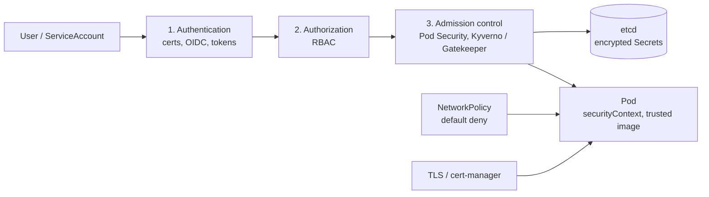


### 50. Authentication & Authorization
- [ ] Users, identities and access decisions

**Essential info:**
- Request flow: **Authentication** (who are you?) → **Authorization** (are you allowed?) → **Admission control** (is the request valid and policy-compliant?).
- Authentication methods: client certificates, bearer/OIDC tokens, ServiceAccount tokens, cloud IAM integration.
- Kubernetes has no built-in user objects; identities come from external sources.
- Authorization modes: RBAC (standard), Node, Webhook, ABAC.
- Test access: `kubectl auth can-i create pods --as dev-user`.

### 51. RBAC
- [ ] Roles, ClusterRoles, RoleBindings and ClusterRoleBindings

**Essential info:**
- **Role:** permissions within a namespace. **ClusterRole:** cluster-wide or non-namespaced resources.
- **RoleBinding / ClusterRoleBinding:** grant a Role/ClusterRole to users, groups or ServiceAccounts.
- Permissions are additive only (no deny rules); rules specify `apiGroups`, `resources`, `verbs`.
- Follow least privilege; avoid binding `cluster-admin` broadly.

### 52. ServiceAccounts
- [ ] Workload identities and API access

**Essential info:**
- Each namespace has a `default` ServiceAccount; create dedicated ones per application.
- Tokens are short-lived and projected into Pods; set `automountServiceAccountToken: false` when the app does not need API access.
- Bind a ServiceAccount to a Role with RBAC. On cloud, link to IAM (IRSA on EKS, Workload Identity on GKE/AKS).

### 53. Security Contexts
- [ ] User IDs, Linux capabilities and privilege restrictions

**Essential info:**
- Set at Pod or container level.
- Recommended hardening:
  ```yaml
  securityContext:
    runAsNonRoot: true
    runAsUser: 1000
    allowPrivilegeEscalation: false
    readOnlyRootFilesystem: true
    capabilities:
      drop: ["ALL"]
    seccompProfile:
      type: RuntimeDefault
  ```
- Avoid `privileged: true`; use `fsGroup` for volume permissions.

### 54. Pod Security Standards
- [ ] Privileged, baseline and restricted profiles

**Essential info:**
- Three profiles: **privileged** (unrestricted), **baseline** (blocks known escalations), **restricted** (hardened best practice).
- Enforced by the built-in **Pod Security Admission** through namespace labels, for example `pod-security.kubernetes.io/enforce=restricted`.
- Modes: `enforce`, `audit`, `warn`. PodSecurityPolicy was removed in v1.25.

### 55. Network & Secret Security
- [ ] Least privilege, isolation and sensitive data protection

**Essential info:**
- Apply default-deny NetworkPolicies, then allow only required flows.
- Encrypt Secrets at rest (`EncryptionConfiguration` or cloud KMS) and restrict `get/list` on Secrets via RBAC.
- Never commit secrets to Git; use sealed or external secrets.
- Restrict access to the API server and etcd; use private endpoints on managed clusters.

### 56. Image Security
- [ ] Trusted images, vulnerability scanning and image provenance

**Essential info:**
- Use minimal base images (distroless, alpine), pin versions or digests (avoid `latest`), and run as non-root.
- Scan with Trivy, Grype or registry scanners in CI.
- Pull from trusted private registries; use `imagePullSecrets`.
- Sign and verify images (Cosign/Sigstore).

### 57. Admission Control
- [ ] Admission controllers and policy enforcement

**Essential info:**
- Admission controllers intercept requests after authN/authZ and before persistence.
- **Mutating** webhooks modify objects; **validating** webhooks accept or reject them.
- Built-ins include `LimitRanger`, `ResourceQuota`, `PodSecurity`; add policy engines such as OPA Gatekeeper or Kyverno.
- Newer option: ValidatingAdmissionPolicy (CEL-based).

### 58. TLS & Certificates
- [ ] Certificates, API security and workload communication

**Essential info:**
- Cluster components communicate over mutual TLS; certificates are stored in `/etc/kubernetes/pki` (kubeadm).
- Control plane certificates typically expire after 1 year; renew with `kubeadm certs renew all`.
- **cert-manager** automates certificates for Ingress (for example, Let's Encrypt).
- A service mesh can add automatic mTLS between workloads.

---

## Phase 7 — Monitoring, Logging & Troubleshooting (0/10 lessons completed)

**Explanation:** Production systems fail, and you need to see why. This phase covers observability (metrics, logs, traces), systematic troubleshooting for Pods, networking, storage and clusters, and backup and disaster recovery.

**Outcome:** You can monitor a cluster, diagnose failures quickly and recover from disasters.

**Phase 7 diagram:**

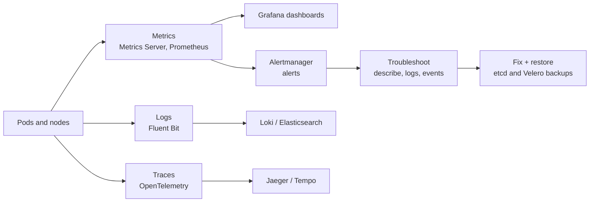


### 59. Kubernetes Observability
- [ ] Metrics, logs and distributed traces

**Essential info:**
- Three pillars: **metrics** (numbers over time), **logs** (event records), **traces** (request paths across services).
- Also use **events** (`kubectl get events --sort-by=.lastTimestamp`) and alerts.
- Typical stack: Prometheus + Grafana + Alertmanager, Loki/EFK, OpenTelemetry + Jaeger/Tempo.
- Monitor the "golden signals": latency, traffic, errors, saturation.

### 60. Metrics Server & kubectl top
- [ ] Inspecting Pod and node resource usage

**Essential info:**
- Metrics Server collects CPU/memory from kubelets and serves the Metrics API; it is required by HPA.
- Commands: `kubectl top nodes`, `kubectl top pods -A --containers`.
- It gives near-real-time data only; it is not for long-term storage (use Prometheus).

### 61. Prometheus & Grafana
- [ ] Metrics collection, dashboards and alerts

**Essential info:**
- Prometheus **scrapes** metrics endpoints and stores time series; queries use PromQL.
- Install via the `kube-prometheus-stack` Helm chart (includes Grafana, Alertmanager, node-exporter, kube-state-metrics).
- Use `ServiceMonitor` / `PodMonitor` to define scrape targets.
- Grafana provides dashboards; Alertmanager routes alerts to Slack, email or PagerDuty.

### 62. Centralized Logging
- [ ] Container logs, Fluent Bit and log aggregation

**Essential info:**
- Containers write to stdout/stderr; the node stores them under `/var/log/containers`.
- Run a log agent (Fluent Bit, Fluentd, Vector) as a **DaemonSet** to ship logs to Loki, Elasticsearch/OpenSearch or a cloud service.
- Use structured (JSON) logs and add metadata (namespace, Pod, labels).
- Logs are lost when a Pod or node disappears unless centralized.

### 63. Distributed Tracing
- [ ] OpenTelemetry and request-flow investigation

**Essential info:**
- A **trace** is a request's journey; it is made of **spans** across microservices, linked by trace IDs.
- **OpenTelemetry** provides vendor-neutral SDKs and a Collector; backends include Jaeger and Tempo.
- Propagate trace context headers (W3C `traceparent`) between services.
- Helps find latency bottlenecks and failing dependencies.

### 64. Troubleshooting Pods
- [ ] Pending, CrashLoopBackOff, ImagePullBackOff and OOMKilled

**Essential info:**
- First steps: `kubectl get pod`, `kubectl describe pod`, `kubectl logs <pod> --previous`.
- **Pending:** insufficient resources, unbound PVC, taints, or affinity mismatch.
- **CrashLoopBackOff:** app crashes at startup; check logs, config, probes and commands.
- **ImagePullBackOff:** wrong image name/tag, missing pull secret, or registry access issue.
- **OOMKilled:** memory limit too low or a leak; raise limits or fix the app.
- Debug with `kubectl debug` or an ephemeral container.

### 65. Troubleshooting Networking
- [ ] DNS failures, Service routing and connectivity

**Essential info:**
- Check in order: Pod Ready → Service selector/endpoints → DNS → NetworkPolicy → Ingress.
- Commands: `kubectl get endpoints <svc>`, `kubectl run tmp --rm -it --image=busybox -- nslookup <svc>`, `kubectl port-forward`.
- Verify CoreDNS Pods in `kube-system` are healthy; confirm `targetPort` matches the container port.

### 66. Troubleshooting Storage
- [ ] PVC Pending, mount errors and filesystem permissions

**Essential info:**
- **PVC Pending:** no default StorageClass, no matching PV, or zone mismatch; read `kubectl describe pvc`.
- **Mount errors (`FailedMount`, `Multi-Attach`):** a `ReadWriteOnce` volume is still attached to another node.
- **Permission denied:** set `securityContext.fsGroup` or `runAsUser` appropriately.
- Inspect events and CSI driver logs.

### 67. Cluster Troubleshooting
- [ ] Node NotReady, events and control plane diagnostics

**Essential info:**
- **Node NotReady:** check `kubectl describe node`, kubelet (`systemctl status kubelet`, `journalctl -u kubelet`), runtime health, disk/memory pressure and CNI.
- Control plane: inspect static Pods in `/etc/kubernetes/manifests` and their logs; check etcd health and certificate expiry.
- Use `kubectl get events -A` and `kubectl get --raw='/readyz?verbose'`.

### 68. Backup & Disaster Recovery
- [ ] etcd backups, application data and restoration planning

**Essential info:**
- Back up **etcd** with `etcdctl snapshot save`; restore with `etcdctl snapshot restore`.
- Back up manifests (use GitOps), PVs (snapshots) and cluster resources with **Velero**.
- Define **RPO** (acceptable data loss) and **RTO** (acceptable downtime); rehearse restores regularly.
- Managed clusters back up the control plane for you, but application data is still your responsibility.

---

## Phase 8 — Administration & Enterprise Architecture (0/11 lessons completed)

**Explanation:** This phase moves from running one cluster to managing Kubernetes as an enterprise platform: lifecycle, managed services, multi-zone and multi-tenant designs, extensibility, packaging, policy and reference architecture.

**Outcome:** You can administer clusters at scale and design a multi-team, multi-zone enterprise architecture.

**Phase 8 diagram:**

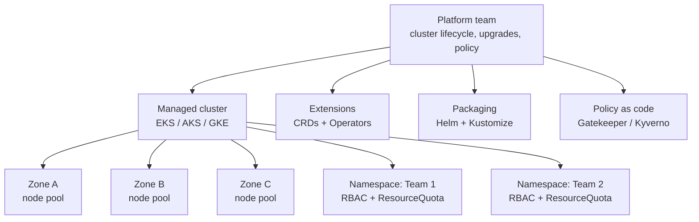


### 69. Cluster Administration
- [ ] Node maintenance, upgrades and cluster lifecycle

**Essential info:**
- Node maintenance: `kubectl cordon <node>` → `kubectl drain <node> --ignore-daemonsets --delete-emptydir-data` → maintain → `kubectl uncordon <node>`.
- Upgrade order: control plane first, then nodes; move only one minor version at a time (for example 1.29 → 1.30).
- Read the release notes for API deprecations; test upgrades in a non-production cluster first.
- Kubernetes supports roughly the three most recent minor versions.

### 70. Managed Kubernetes
- [ ] Amazon EKS, Azure AKS and Google GKE

**Essential info:**

| Service | Provider | Notes |
|---------|----------|-------|
| EKS | AWS | IAM roles for service accounts (IRSA), managed node groups, Fargate |
| AKS | Azure | Entra ID (Azure AD) integration, free control plane tier |
| GKE | Google Cloud | Autopilot mode, strong auto-upgrade features |

- The provider manages the control plane and its availability; you manage worker nodes (unless serverless), add-ons and workloads.
- Provision with Terraform or the provider CLI (`eksctl`, `az aks`, `gcloud container`).

### 71. Multi-Node & Multi-Zone Design
- [ ] Failure domains, availability zones and capacity

**Essential info:**
- Spread nodes across at least 3 availability zones; use topology spread constraints to distribute Pods.
- Plan capacity for N+1 (or zone-loss) scenarios and keep headroom for autoscaling.
- Use separate node pools for different workloads (GPU, spot, system).
- Beware cross-zone data transfer costs and zone-bound volumes.

### 72. Multi-Tenancy
- [ ] Namespace isolation, quotas and shared clusters

**Essential info:**
- **Soft multi-tenancy:** namespaces per team with RBAC, quotas, NetworkPolicy and Pod Security.
- **Hard multi-tenancy:** separate clusters or virtual clusters (vcluster) for strong isolation.
- Consider noisy neighbors, shared control plane limits, and cost allocation by labels/namespaces.

### 73. ResourceQuotas & LimitRanges
- [ ] Controlling resource consumption

**Essential info:**
- **ResourceQuota:** caps total resources per namespace (CPU, memory, Pod count, PVCs).
- **LimitRange:** sets default, minimum and maximum requests/limits per container or Pod.
- When a quota covers CPU/memory, Pods must declare requests/limits, which LimitRange can default.

```yaml
apiVersion: v1
kind: ResourceQuota
metadata:
  name: team-quota
spec:
  hard:
    requests.cpu: "10"
    requests.memory: 20Gi
    pods: "50"
```

### 74. Custom Resource Definitions
- [ ] Extending Kubernetes APIs

**Essential info:**
- A CRD adds a new resource type (for example `Certificate`, `Database`) served by the API server.
- Define the schema with OpenAPI v3 validation; manage with `kubectl` like built-ins.
- A CRD by itself only stores data; a controller gives it behavior.

### 75. Operators & Controllers
- [ ] Automating complex application operations

**Essential info:**
- An **Operator** = CRD + custom controller that encodes operational knowledge (install, backup, failover, upgrade).
- Examples: Prometheus Operator, cert-manager, Strimzi (Kafka), Zalando/CloudNativePG (PostgreSQL).
- Build with Kubebuilder, Operator SDK or Kopf. Find existing ones on OperatorHub.io.

### 76. Helm
- [ ] Charts, templates, values and release management

**Essential info:**
- Helm is the package manager for Kubernetes: a **chart** contains templates, `values.yaml` and metadata; an installed chart is a **release**.
- Commands:
  ```bash
  helm repo add bitnami https://charts.bitnami.com/bitnami
  helm install my-release bitnami/nginx -f values.yaml
  helm upgrade my-release bitnami/nginx --set replicaCount=3
  helm rollback my-release 1
  helm uninstall my-release
  ```
- Preview with `helm template` and `helm lint`; Helm 3 has no Tiller.

### 77. Kustomize
- [ ] Environment-specific YAML customization

**Essential info:**
- Template-free customization built into `kubectl` (`kubectl apply -k <dir>`).
- Structure: a `base/` directory plus `overlays/dev|staging|prod` with patches.
- Features: `namePrefix`, `commonLabels`, `images` overrides, `configMapGenerator`, strategic-merge and JSON patches.

### 78. Policy as Code
- [ ] OPA Gatekeeper, Kyverno and compliance controls

**Essential info:**
- Express rules as versioned code and enforce them at admission time.
- **OPA Gatekeeper:** uses Rego policies through ConstraintTemplates. **Kyverno:** Kubernetes-native YAML policies (validate, mutate, generate).
- Example rules: require resource limits, disallow `latest` tag, require labels, block privileged Pods.
- Start in audit mode before enforcing.

### 79. Enterprise Reference Architecture
- [ ] Ingress, services, microservices, databases, security and observability

**Essential info:**
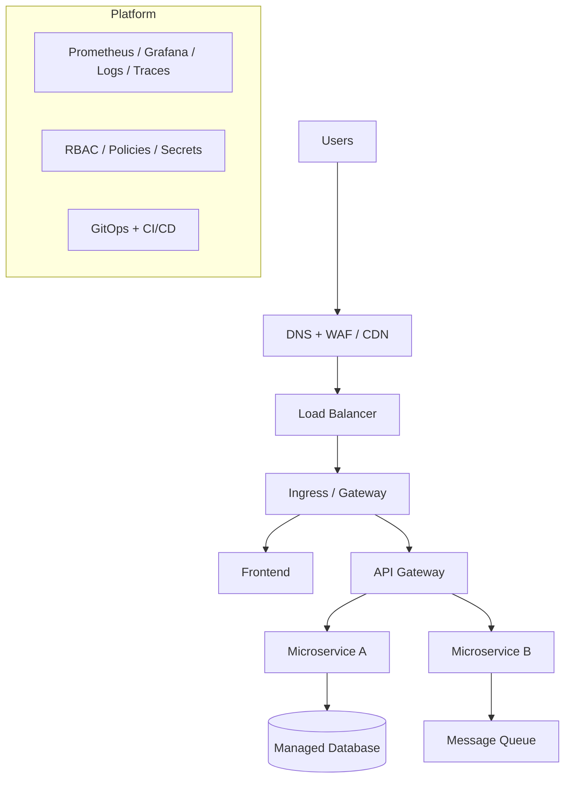
- Principles: multi-zone HA, separate environments, GitOps delivery, least-privilege security, full observability, tested backups, and cost visibility.

---

## Phase 9 — DevOps, GitOps & Capstone (1/10 lessons completed)

**Explanation:** The final phase connects Kubernetes to the software delivery lifecycle: CI/CD pipelines, GitOps, safe release strategies, secrets integrations, service mesh, supply chain security, FinOps, and a capstone project that ties everything together.

**Outcome:** You can ship changes to Kubernetes automatically, safely and repeatably, and design a complete production platform.

**Phase 9 diagram:**

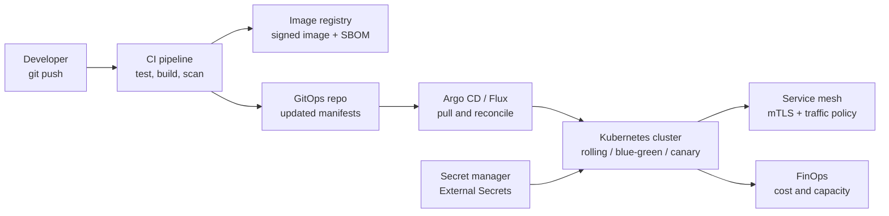


### 80. CI/CD for Kubernetes
- [ ] Build, test, scan, publish and deploy

**Essential info:**
- Pipeline stages: lint/test → build image → scan → push to registry → deploy → verify.
- Tools: GitHub Actions, GitLab CI, Jenkins, Tekton, Azure DevOps.
- Tag images with the Git SHA (immutable), not just `latest`.
- Use short-lived credentials (OIDC) rather than long-lived cluster keys.

### 81. GitOps Fundamentals
- [ ] Git as the source of truth and declarative reconciliation

**Essential info:**
- Principles: declarative config, versioned in Git, automatically pulled and applied, continuously reconciled.
- **Pull-based** deployment: an in-cluster agent pulls changes, so the CI system needs no cluster credentials.
- Benefits: audit trail, easy rollback (`git revert`), drift detection and consistent environments.
- Keep app code and environment config in separate repos or directories.

### 82. Argo CD or Flux
- [ ] Continuous delivery and environment synchronization

**Essential info:**
- **Argo CD:** web UI, `Application` CRD, sync status and health views, supports Helm, Kustomize and plain YAML.
- **Flux:** modular controllers (`GitRepository`, `Kustomization`, `HelmRelease`), CLI-centric, strong Kubernetes-native design.
- Both support auto-sync, self-heal (revert manual drift) and pruning of removed resources.
- Pattern: "app of apps" or ApplicationSets to manage many clusters and environments.

### 83. Deployment Strategies
- [x] Rolling, blue-green and canary deployments

**Essential info:**
- **Rolling:** replace Pods gradually (Kubernetes default); simple, but old and new versions briefly coexist.
- **Blue-green:** run two full environments and switch traffic at once (for example by changing a Service selector); instant rollback, double capacity cost.
- **Canary:** send a small percentage of traffic to the new version and increase gradually; lowest risk.
- Tools: Argo Rollouts, Flagger, service mesh or Gateway API traffic splitting.
- **Recreate:** stop old, start new; downtime but simple.

### 84. Secrets Management Integrations
- [ ] External Secrets Operator and secret managers

**Essential info:**
- Keep secrets in a dedicated manager: AWS Secrets Manager, Azure Key Vault, GCP Secret Manager, HashiCorp Vault.
- **External Secrets Operator** syncs external secrets into Kubernetes Secrets (`SecretStore` + `ExternalSecret`).
- Alternatives: Secrets Store CSI Driver (mount directly), Vault Agent Injector, Sealed Secrets or SOPS (encrypted secrets in Git).
- Benefits: rotation, auditing, central control.

### 85. Service Mesh Fundamentals
- [ ] Istio, Linkerd, mTLS and traffic policies

**Essential info:**
- A service mesh adds a networking layer (sidecar proxies or ambient/eBPF) for service-to-service traffic.
- Features: automatic **mTLS**, retries, timeouts, circuit breaking, traffic splitting, and rich telemetry.
- **Istio:** feature-rich and complex. **Linkerd:** lightweight and simple.
- Adds resource overhead and complexity; adopt only when you need these capabilities.

### 86. Supply Chain Security
- [ ] SBOMs, image signing and artifact verification

**Essential info:**
- **SBOM** (Software Bill of Materials): list of components in an image (generate with Syft, Trivy).
- **Signing and verification:** Cosign/Sigstore; enforce with Kyverno or admission policies.
- Frameworks: SLSA levels and in-toto attestations for build provenance.
- Pin dependencies, use trusted base images, and scan continuously.

### 87. FinOps & Capacity Planning
- [ ] Resource efficiency, cost visibility and right-sizing

**Essential info:**
- Right-size requests/limits using real usage (VPA recommendations, Prometheus data).
- Use autoscaling, spot/preemptible nodes for fault-tolerant workloads, and reserved capacity for steady loads.
- Allocate costs by namespace and label; tools include Kubecost and OpenCost.
- Clean up idle resources: unused PVCs, load balancers and dev environments.

### 88. Kubernetes Interview & Architecture Review
- [ ] Scenario-based troubleshooting and design decisions

**Essential info:**
- Be ready to explain: what happens on `kubectl apply`, Pod lifecycle, Service vs Ingress, Deployment vs StatefulSet, and how scheduling works.
- Practice scenarios: CrashLoopBackOff, Pending Pods, 502 errors via Ingress, node failure, zero-downtime deployments.
- Architecture review checklist: availability, security, observability, scalability, cost, disaster recovery.
- Prepare for certifications: CKA, CKAD, CKS.

### 89. Capstone Project
- [ ] Deploy a production-style microservices application end to end

**Essential info:**
- Suggested scope: 3+ microservices, a database with a PVC, Ingress with TLS, ConfigMaps and Secrets, probes, resource limits, HPA, NetworkPolicies and RBAC.
- Add operations: Prometheus/Grafana monitoring, centralized logging, and a CI/CD pipeline with GitOps (Argo CD or Flux).
- Package with Helm or Kustomize, deploy to a managed cluster, and document the architecture, runbooks and backup/restore tests.

---

The syllabus follows the main areas of the official Kubernetes documentation, including architecture, workloads, networking, storage, configuration, security, resource management and observability.

## Recommended Hands-On Practice

| Stage | Practical exercise |
|-------|--------------------|
| Fundamentals | Install Minikube or kind and inspect the cluster |
| Workloads | Deploy a Node.js application with three replicas |
| Networking | Expose the application using a Service and Ingress |
| Storage | Attach a PVC and verify data survives Pod replacement |
| Scaling | Configure resource requests and autoscaling |
| Security | Configure RBAC and a restricted workload |
| Operations | Diagnose failed Pods and investigate logs |
| Enterprise | Deploy a microservices application with monitoring and GitOps |
