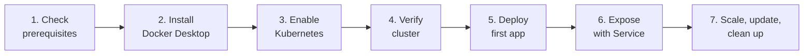

# Docker Desktop Kubernetes — Installation & Cluster Creation (Step by Step)

Docker Desktop includes a built-in Kubernetes cluster that you can enable with one setting. It is the quickest way to get a local cluster on Windows, macOS or Linux for learning, development and testing.

> This is a **local development cluster**, not a production setup. For production, see managed Kubernetes (EKS, AKS, GKE) in [`36-Kubernetes-foundation-roadmap`](../36-Kubernetes-foundation-roadmap/README.md).

## What You Will Do



---

## 1. Prerequisites

| Requirement | Recommended |
|-------------|-------------|
| OS | Windows 10/11 (64-bit), macOS, or Linux |
| CPU | 64-bit CPU with virtualization enabled in BIOS/UEFI |
| RAM | 8 GB minimum (16 GB recommended) |
| Disk | At least 10 GB free |
| Windows backend | WSL 2 (recommended) or Hyper-V |

Enable WSL 2 on Windows (run PowerShell as Administrator, then restart):

```powershell
wsl --install
wsl --set-default-version 2
wsl --status
```

## 2. Install Docker Desktop

1. Download Docker Desktop from the official site: <https://www.docker.com/products/docker-desktop/>
2. Run the installer and keep **Use WSL 2 instead of Hyper-V** selected (Windows).
3. Restart the computer if prompted, then start Docker Desktop.
4. Wait until the Docker icon in the system tray shows **Engine running**.

Verify the installation:

```powershell
docker --version
docker run hello-world
```

## 3. Enable Kubernetes in Docker Desktop

1. Open **Docker Desktop**.
2. Click the **Settings** (gear) icon.
3. Select **Kubernetes** in the left menu.
4. Turn on **Enable Kubernetes**.
5. Choose the cluster type if the option is shown in your version:

   | Option | Description |
   |--------|-------------|
   | **kubeadm** | Single-node cluster; the simplest choice for learning |
   | **kind** | Multi-node cluster running as containers; useful to practise scheduling and node concepts |

6. (Optional) Tick **Show system containers (advanced)** to see Kubernetes system containers in `docker ps`.
7. Click **Apply & restart** (or **Create** / **Install**, depending on the version).
8. Wait for the first start. Docker Desktop pulls the Kubernetes images, which can take several minutes. The Kubernetes status at the bottom-left of the window turns **green** when the cluster is ready.

> The options and button names vary slightly between Docker Desktop versions. If a setting is missing, update Docker Desktop to the latest version.

## 4. Verify the Cluster

Docker Desktop installs `kubectl` and configures it automatically.

```powershell
kubectl version --client
kubectl config get-contexts
kubectl config use-context docker-desktop
kubectl cluster-info
kubectl get nodes
kubectl get pods -A
```

Expected result:

```text
NAME             STATUS   ROLES           AGE   VERSION
docker-desktop   Ready    control-plane   2m    v1.xx.x
```

- `STATUS` must be `Ready`.
- System Pods (CoreDNS, kube-proxy, etcd, API server and others) in `kube-system` should be `Running`.

## 5. Deploy Your First Application

### Option A: Using commands

```powershell
kubectl create deployment web --image=nginx:1.27 --replicas=2
kubectl get deployments
kubectl get pods -o wide
```

### Option B: Using a YAML manifest

Create a file named `web-deployment.yaml`:

```yaml
apiVersion: apps/v1
kind: Deployment
metadata:
  name: web
  labels:
    app: web
spec:
  replicas: 2
  selector:
    matchLabels:
      app: web
  template:
    metadata:
      labels:
        app: web
    spec:
      containers:
        - name: nginx
          image: nginx:1.27
          ports:
            - containerPort: 80
```

Apply it:

```powershell
kubectl apply -f web-deployment.yaml
kubectl rollout status deployment/web
kubectl get pods
```

## 6. Expose the Application with a Service

Create `web-service.yaml`:

```yaml
apiVersion: v1
kind: Service
metadata:
  name: web-service
spec:
  type: LoadBalancer
  selector:
    app: web
  ports:
    - port: 8080
      targetPort: 80
```

```powershell
kubectl apply -f web-service.yaml
kubectl get service web-service
```

On Docker Desktop, a `LoadBalancer` Service is reachable on `localhost`. Open <http://localhost:8080> in the browser to see the NGINX welcome page.

Alternative access methods:

```powershell
# Temporary tunnel from your machine to the Service
kubectl port-forward service/web-service 8081:8080

# NodePort instead of LoadBalancer
kubectl expose deployment web --type=NodePort --port=80 --name=web-nodeport
kubectl get service web-nodeport
```

## 7. Scale, Update and Roll Back

```powershell
# Scale
kubectl scale deployment web --replicas=4
kubectl get pods

# Rolling update
kubectl set image deployment/web nginx=nginx:1.27-alpine
kubectl rollout status deployment/web
kubectl rollout history deployment/web

# Roll back
kubectl rollout undo deployment/web
```

## 8. Inspect and Troubleshoot

```powershell
kubectl describe pod <pod-name>
kubectl logs <pod-name>
kubectl exec -it <pod-name> -- /bin/sh
kubectl get events --sort-by=.lastTimestamp
```

## 9. Use Your Own Local Image

Docker Desktop's cluster shares the local Docker image store, so locally built images can be used without pushing to a registry.

```powershell
docker build -t my-app:1.0 .
kubectl create deployment my-app --image=my-app:1.0
kubectl set image deployment/my-app my-app=my-app:1.0
```

Set `imagePullPolicy: IfNotPresent` (or `Never`) and use a specific tag (not `latest`) so Kubernetes does not try to pull from a remote registry.

> With the **kind** provisioner, nodes are separate containers, so local images may need to be loaded into the cluster or pushed to a registry.

## 10. Optional: Install the Kubernetes Dashboard

```powershell
helm repo add kubernetes-dashboard https://kubernetes.github.io/dashboard/
helm upgrade --install kubernetes-dashboard kubernetes-dashboard/kubernetes-dashboard --create-namespace --namespace kubernetes-dashboard
kubectl -n kubernetes-dashboard port-forward svc/kubernetes-dashboard-kong-proxy 8443:443
```

Open <https://localhost:8443>. A login token is required, so create a ServiceAccount and token by following the [Kubernetes Dashboard documentation](https://github.com/kubernetes/dashboard).

## 11. Clean Up

Delete the resources created in this guide:

```powershell
kubectl delete -f web-service.yaml
kubectl delete -f web-deployment.yaml
kubectl delete deployment my-app --ignore-not-found
kubectl delete service web-nodeport --ignore-not-found
```

## 12. Reset or Disable the Cluster

| Goal | Steps |
|------|-------|
| Reset to a clean cluster | Settings → Kubernetes → **Reset Kubernetes Cluster** |
| Stop Kubernetes | Settings → Kubernetes → turn off **Enable Kubernetes** → **Apply & restart** |
| Free resources | Settings → Resources → lower CPU/memory, or quit Docker Desktop |

---

## Common Problems and Fixes

| Problem | Likely cause | Fix |
|---------|--------------|-----|
| Kubernetes stuck on "Starting" | Not enough resources or a slow image download | Increase memory/CPU in Settings → Resources, check internet, then **Reset Kubernetes Cluster** |
| `kubectl: command not found` | `kubectl` not on PATH | Restart the terminal, or install it from <https://kubernetes.io/docs/tasks/tools/> |
| `Unable to connect to the server` | Wrong context or cluster not running | `kubectl config use-context docker-desktop` and confirm the green Kubernetes status |
| Pod stuck in `ImagePullBackOff` | Wrong image name/tag or no registry access | Check the name with `kubectl describe pod`; build the image locally or log in to the registry |
| Pod stuck in `Pending` | Insufficient CPU/memory | Reduce replicas or raise Docker Desktop resources |
| `localhost:8080` not responding | Service not ready or port conflict | `kubectl get svc`, `kubectl get endpoints`, or use `kubectl port-forward` |
| Context points to another cluster | Multiple clusters in kubeconfig | `kubectl config get-contexts` then `kubectl config use-context docker-desktop` |

## Quick Command Reference

| Task | Command |
|------|---------|
| Show contexts | `kubectl config get-contexts` |
| Switch context | `kubectl config use-context docker-desktop` |
| Cluster info | `kubectl cluster-info` |
| List nodes | `kubectl get nodes` |
| List all Pods | `kubectl get pods -A` |
| Apply manifest | `kubectl apply -f <file>` |
| Delete manifest | `kubectl delete -f <file>` |
| Logs | `kubectl logs <pod>` |
| Shell in Pod | `kubectl exec -it <pod> -- /bin/sh` |
| Scale | `kubectl scale deployment <name> --replicas=<n>` |
| Rollback | `kubectl rollout undo deployment/<name>` |

## Next Steps

- Learn the architecture: [`29-Kubernetes`](../29-Kubernetes), [`30-Kubernetes-worker-nodes`](../30-Kubernetes-worker-nodes), [`31-Kubernetes-master-nodes`](../31-Kubernetes-master-nodes)
- Practise Deployments: [`32-Kubernetes-deployment`](../32-Kubernetes-deployment)
- Follow the full learning path: [`36-Kubernetes-foundation-roadmap`](../36-Kubernetes-foundation-roadmap/README.md)

## References

- [Docker Desktop: Deploy on Kubernetes](https://docs.docker.com/desktop/features/kubernetes/)
- [Install Docker Desktop on Windows](https://docs.docker.com/desktop/setup/install/windows-install/)
- [Kubernetes Documentation](https://kubernetes.io/docs/home/)
- [kubectl Cheat Sheet](https://kubernetes.io/docs/reference/kubectl/cheatsheet/)
